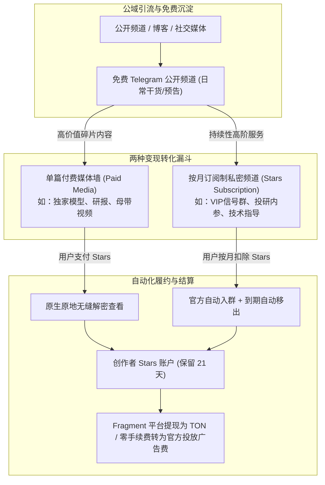
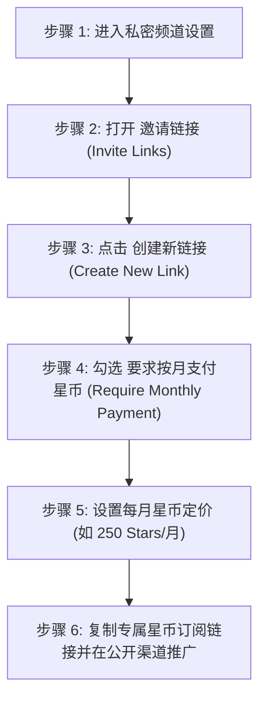
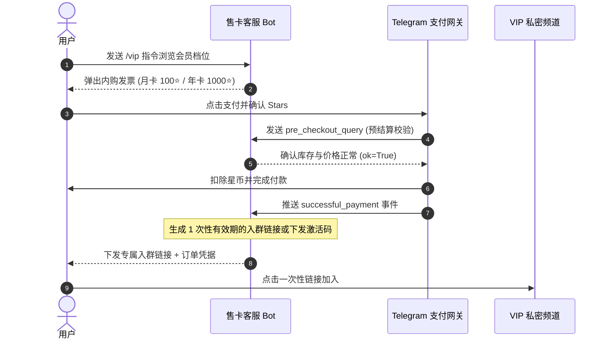
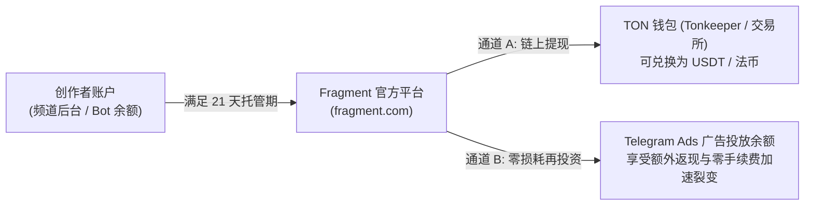

# Telegram Stars 星币付费频道与内容墙变现搭建完全指南：按月订阅、付费媒体与知识付费实战

在传统内容变现与社群运营中，创作者常常饱受痛点困扰：使用第三方发卡网容易被封链接；接入传统跨境聚合支付手续费高昂且极易触发风控冻结；采用人工核对转账截图不仅耗费巨大精力，还频繁面临漏单、用户到期无法自动踢出、内容被肆意截图转发等繁重维护负担。

2024 年下半年起，Telegram 推出了革命性的 **Telegram Stars（星币）原生内容变现体系**，让知识博主、分析师、数字艺术家、软件开发者能够以零人工干预、全球合规收单的方式，直接在客户端内搭建起完整的“付费内容墙”与“自动续期订阅制私密频道”。

本文将由浅入深，全面拆解单篇付费媒体（Paid Media）、按月周期订阅链接（Stars Subscriptions）、Bot 自动化会员发卡，以及版权防录屏保护与 Fragment 链上提现的完整闭环。

---

## 一、传统社群变现 vs Telegram 原生 Stars 付费生态

在规划你的商业变现之前，清晰了解 Telegram 原生 Stars 付费方案相对传统第三方方案的优势至关重要：

| 评估维度 | 传统第三方发卡 / 人工收费进群 | Telegram 官方 Stars 原生付费方案 |
| :--- | :--- | :--- |
| **支付转化门槛** | 需跳出 App 访问外部网页，易被拦截或阻断 | **App 内一键唤起** Apple Pay / Google Pay，转化率提升 3 倍以上 |
| **进群与鉴权机制** | 手动发送邀请链接，或依赖第三方脚本易掉单 | **官方原生全自动**：支付成功秒级自动进群并赋予权限 |
| **到期踢群维护** | 需人工每日比对 Excel 表格，手动踢出到期人员 | **官方全自动生命周期管理**：到期未续费系统自动移出，零人工损耗 |
| **单篇内容购买** | 难以在频道内对单条消息设卡，多靠打包网盘 | **原生单篇内容墙 (Paid Media)**：模糊遮罩，付费后原地无缝解密 |
| **版权防盗搬** | 转发、截图、下载无法受到客户端底层约束 | **官方版权防盗保护**：底层限制转发、禁止截图录屏、禁止本地保存 |
| **合规与资金安全** | 频繁遭遇第三方支付跑路、商户号被冻结资金 | **Telegram 官方结算**：21 天后可随时在 Fragment 平台提现为 TON |



---

## 二、模式一：单篇付费媒体墙（Paid Media）搭建

**适用场景**：独立调研研报、专业交易策略长图、4K 高清未公开视频教程、设计源文件/插画作品、独家访谈等高客单价碎片化内容。

### 2.1 手机端与桌面端发布实操

在频道中发布付费内容无需编写任何代码，直接在频道编辑窗口即可完成：

1. **选择媒体素材**：打开你的 Telegram 频道，点击附件图标（回形针），选择 1 张或多张图片/视频（可一次性打包多个媒体文件）。
2. **设置付费解密**：
   - **iOS / Android**：选中媒体后，点击输入框右上角或媒体预览区的 **「...」（更多选项）**，在弹出菜单中选择 **「设为付费媒体」(Make Paid Media)**。
   - **Desktop 桌面端**：在发送前右键点击待发送的图片/视频缩略图，选择 **「Require Stars to View」**。
3. **设定 Stars 价格**：
   - 输入解锁该媒体所需的 Stars（星币）数量（例如 `25` Stars，约合 0.5 美元；`100` Stars，约合 2 美元）。
4. **撰写诱饵文案（Caption）**：
   - 撰写一段精彩的引言与摘要介绍。文案部分是**公开免费可见**的，而图片/视频会自动覆盖一层**磨砂玻璃式模糊遮罩（Blurred Preview）**，并带有一把锁图标和价格标签。
5. **点击发送**：消息发出后，所有订阅者均可在信息流中看到，仅付费用户点击后会扣除星币并瞬间原地高清解锁。

::: tip 高转化率定价与呈现技巧
1. **价格带黄金分割**：测试数据表明，单篇付费媒体在 **15 ~ 50 Stars**（约 $0.3 ~ $1.0）区间的冲动购买率最高，适合日常轻量知识点；而深度研报与整套源码适合设置在 **100 ~ 500 Stars**。
2. **充分暴露核心痛点**：文案末尾一定要清晰列出“付费后你将解锁的具体清单（如：3份PDF附件、1套实测指标、高清不打码视频）”，降低用户的支付疑虑。
:::

### 2.2 开发者方案：通过 Bot API 发送付费媒体

如果你运营着全自动资讯 Bot 或会员系统，可通过 Telegram Bot API 的 `sendPaidMedia` 方法批量发布：

```python
import asyncio
from telegram import Bot, InputPaidMediaPhoto, InputPaidMediaVideo

async def publish_paid_content():
    bot = Bot(token="YOUR_BOT_TOKEN")
    channel_id = "@your_channel_username"
    
    # 构造付费媒体组合 (支持照片与视频混编)
    media_list = [
        InputPaidMediaPhoto(media=open("report_preview.jpg", "rb")),
        InputPaidMediaPhoto(media=open("data_chart.jpg", "rb"))
    ]
    
    await bot.send_paid_media(
        chat_id=channel_id,
        star_count=50,  # 设定解锁所需星币数 (50 Stars)
        media=media_list,
        caption="📊 【10月首周核心投研数据】点击下方支付 50 星币即可解锁全部高分辨率图表。",
        parse_mode="Markdown"
    )

if __name__ == "__main__":
    asyncio.run(publish_paid_content())
```

---

## 三、模式二：按月周期订阅制私密频道（Stars Subscriptions）

这是长期稳定“睡后收入”的核心支柱。创作者无需借助任何第三方 Bot，仅使用 Telegram 原生功能就能创建**自动按月扣款、自动踢人**的 VIP 私密频道。

### 3.1 开启条件与准备工作

- **频道所有权**：必须是频道的 **Owner（创建者）** 或拥有“管理邀请链接”最高权限的管理员。
- **频道属性**：必须是 **私密频道 (Private Channel)**。如果是公开频道，请在「频道类型」中临时切换为私密，或者专门为付费会员新建一个独立的私密频道。

### 3.2 创作者后台配置四步走



1. **进入邀请链接管理**：
   - 打开你的私密频道，点击频道头像 ➡️ **「编辑 (Edit)」** ➡️ **「邀请链接 (Invite Links)」**。
2. **创建订阅制专属链接**：
   - 点击 **「创建新链接 (Create a New Link)」**。
   - 自定义链接名称（例如 `VIP月度会员入口`，便于后台分渠道统计）。
3. **激活按月扣费规则**：
   - 在链接选项中找到并开启 **「要求按月支付星币 (Require Monthly Payment in Stars)」**。
   - 输入每个自然月的定价（例如 `100` Stars/月 或 `500` Stars/月）。
4. **生成与分发**：
   - 点击保存，系统会生成一条特殊的 `t.me/+xxxxxx` 付费邀请链接。
   - 当潜在用户点击该链接时，Telegram 客户端不会直接加入群组，而是弹出一个原生订阅结算弹窗，清晰告知扣款周期与规则。

### 3.3 官方自动化履约与扣费机制解析

官方原生订阅链接具备极强的自动化韧性，免去了创作者 99% 的运营工作：

- **即时入群**：用户首次确认支付后，立即自动获批进入私密频道。
- **周期自动续费**：每个结算周期（通常为 30 天）到达前，Telegram 客户端会自动尝试通过用户账户中的 Stars 余额进行静默续订。
- **欠费宽限期与自动移出**：若用户账户内 Stars 不足，系统会发送提醒；若宽限期结束后仍扣费失败，**Telegram 系统会自动将该用户移出频道**，用户失去浏览历史与新消息的权限。
- **随时退订保障**：用户可以在个人设置的「Telegram Stars」账单中自主管理或取消续费，符合全球应用商店的内购合规准则。

---

## 四、模式三：结合 Bot 搭建多级阶梯会员与数字资产交付

如果你的商业模式不仅局限于“单一按月订阅”，而是包含**季付、年付、终身买断**，或者购买后自动下发 License Key（激活码）、Notion 知识库模板等虚拟资产，可以通过 Telegram 官方 Bot 的星币发票系统（Invoice API）进行扩展。

### 4.1 混合架构时序图



### 4.2 Python 核心代码实现：发行 Stars 发票与全自动履约

```python
from telegram import Update, LabeledPrice
from telegram.ext import ApplicationBuilder, CommandHandler, PreCheckoutQueryHandler, MessageHandler, filters, ContextTypes

# 1. 弹出星币发票
async def buy_vip(update: Update, context: ContextTypes.DEFAULT_TYPE):
    chat_id = update.effective_chat.id
    
    # 标题、描述与价格 (100 Stars)
    title = "VIP 频道终身独家席位"
    description = "支付 1000 Stars 即可解锁核心 VIP 私密频道并获取独家知识库。"
    payload = "Custom-Payload-VIP-Lifetime-001"
    currency = "XTR"  # Telegram Stars 的法定货币代码为 XTR
    prices = [LabeledPrice(label="VIP 终身席位", amount=1000)]

    await context.bot.send_invoice(
        chat_id=chat_id,
        title=title,
        description=description,
        payload=payload,
        provider_token="",  # Stars 原生支付无需第三方提供商 Token，留空即可
        currency=currency,
        prices=prices
    )

# 2. 预检请求回调 (必须在 10 秒内确认)
async def precheckout_callback(update: Update, context: ContextTypes.DEFAULT_TYPE):
    query = update.pre_checkout_query
    # 校验 payload 与库存状态
    if query.invoice_payload.startswith("Custom-Payload-VIP"):
        await query.answer(ok=True)
    else:
        await query.answer(ok=False, error_message="订单异常，请重试。")

# 3. 支付成功后自动下发一次性入群邀请
async def successful_payment_callback(update: Update, context: ContextTypes.DEFAULT_TYPE):
    chat_id = update.effective_chat.id
    vip_channel_id = -1001234567890  # 你的目标私密频道 ID
    
    # 动态生成限制使用 1 次的邀请链接
    invite_link = await context.bot.create_chat_invite_link(
        chat_id=vip_channel_id,
        member_limit=1,
        name=f"User-{chat_id}-VIP"
    )
    
    await update.message.reply_text(
        f"🎉 支付成功！已收到您的 1,000 Stars。\n\n"
        f"这是您的专属一次性 VIP 入口链接：\n{invite_link.invite_link}\n\n"
        f"⚠️ 注意：该链接仅限本人使用一次，进入后请勿退群。"
    )
```

---

## 五、创作者内容资产保护：防盗搬、防录屏与防截图实战

做知识付费与独家内容，最忌惮“一人购买，全网盗版”。Telegram 在移动客户端底层提供了坚实的内容保护壁垒。

### 5.1 开启「限制保存内容」(Restrict Saving Content)

在付费私密频道中，务必开启官方的防盗保护：

1. 打开频道设置 ➡️ **「编辑 (Edit)」** ➡️ **「频道类型 (Channel Type)」**。
2. 滑动到最底部，勾选并开启 **「保护内容 (Restrict Saving Content)」**。
3. 点击右上角完成保存。

::: warning 开启保护后的技术效果
- **禁止转发**：订阅者无法将频道内的任何消息、视频、音频或图片转发给其他联系人或外部群组。
- **禁止本地保存**：客户端右键菜单中的“图片另存为”、“保存视频到相册”选项全部被剥离。
- **Android / iOS 防截屏**：在移动设备上尝试截屏时，系统级截屏操作会被黑屏拦截，或直接弹出“由于安全策略禁止截屏”警告；录屏软件捕获的画面全部为黑屏。
:::

### 5.2 隐形水印与动态溯源策略

虽然客户端底层能防御绝大多数普通用户的翻录行为，但面对“用另一台手机对着屏幕拍照”的极端盗录者，成熟创作者应采取以下补充手段：

1. **半透明底纹水印**：在深度 PDF 研报中嵌入购买者的 Telegram ID 或专属编码。
2. **内容切片与分期交付**：将核心教程拆分为持续连载更新，拉长服务周期，削弱一次性打包盗录的价值。
3. **高频互动与答疑**：将社群的核心价值从单纯的“静态素材”迁移至“创作者一对一互动与咨询”，服务本身无法被盗版。

---

## 六、收益结算：将 Stars 提现为 TON 或转为广告费

创作者辛苦赚取的 Stars 星币如何变成真金白银？Telegram 通过其官方去中心化交易平台 **Fragment** 提供了极其流畅的链上结算通道。



### 6.1 21 天托管保护机制（Escrow Period）

为防止信用卡盗刷和应用商店恶意拒付，用户支付的 Stars 在到达创作者账户后，会有 **21 天的保护冻结期**。
- 在冻结期内，你可以在频道后台的「创收 (Monetization)」面板查看“待结算 (Pending)”金额。
- 满 21 天后，该部分 Stars 将自动转入“可提取 (Available)”状态。

### 6.2 Fragment 提现步骤实操

1. **进入创收面板**：
   - 在手机端打开频道设置 ➡️ **「统计 (Statistics)」** ➡️ **「创收 (Monetization)」**。
   - 查看当前可用星币余额（最低提现额度为 **1,000 Stars**）。
2. **发起提现至 Fragment**：
   - 点击 **「提现 (Withdraw)」**，系统将引导你通过浏览器访问官方提现门户 [fragment.com](https://fragment.com/)。
3. **连接 TON 去中心化钱包**：
   - 在 Fragment 上登录你频道的绑定账号，并连接你的 TON 钱包（推荐使用 [Tonkeeper](../ton/ton.md)）。
4. **兑换并确认上链**：
   - 确认兑换汇率并签署交易。
   - 系统会自动销毁对应的 Stars，并将等值的 **TON 代币**直接打入你的个人加密钱包地址。
   - 收到 TON 后，可随时转入主流交易所兑换为 USDT 或法币出金。

### 6.3 费率明细与免手续费广告转投

| 结算路径 | 转换损耗 | 到账时效 | 适合场景 |
| :--- | :--- | :--- | :--- |
| **提取为 TON 链上代币** | 扣除平台服务费与链上 Gas（约几美分） | 几分钟内上链 | 团队发薪、利润变现、离岸储备 |
| **转投 Telegram Ads 广告** | **0% 手续费 + 官方额外赠送津贴** | 实时充值 | 频道再投资、矩阵扩圈、公域引流拉新 |

---

## 七、创作者常见疑问与运营避坑指南（FAQ）

### Q1: 为什么我在频道设置里找不到“要求按月支付星币”的邀请链接选项？
**排查清单**：
1. **公开频道无法开启**：必须是**私密频道**。如果你的频道有公开用户名（@username），请先新建一个私密子频道作为付费专享群。
2. **身份权限**：只有频道 **创建者 (Owner)** 才有权配置涉及资金变现的专属链接，普通管理员不可操作。
3. **客户端版本过低**：请升级至官方 Telegram 客户端最新版本（不支持第三方精简版客户端）。

### Q2: 遇到用户恶意退款（Chargeback）会怎么样？
如果某个用户在 App Store 或 Google Play 发起恶意拒付，Telegram 会自动将其判定为违规，并从系统扣除该笔退款；若该用户恶意欺诈，其 Telegram 账号将被官方限制或封禁。对于创作者，21 天托管期的设计正是为了隔离此类账单坏账风险。

### Q3: 免费公开频道与付费私密频道该如何协同运营？
**黄金 80/20 运营模型**：
- **80% 免费公开频道**：高频发布行业资讯、干货切片、精彩观点，通过 SEO 和外部推广建立信任和品牌知名度。
- **20% 核心付费频道**：提供高质量落地执行方案、一手内幕数据、专属答疑与社群互动，在公开频道定期释出“付费单篇媒体”作为试吃钩子，引流至月度订阅私密群。

---

## 相关阅读

- [Telegram 50% 官方广告收益分成与 TON 变现实战指南](./ad-revenue-sharing.md) — 千粉门槛、结算算法与被动收入优化
- [Telegram Stars 星币完全指南](../../stars.md) — 星币生态、充值流程与开发者 API
- [Telegram 频道变现完全指南](../../monetization.md) — 广告分成、付费媒体、会员订阅商业化全攻略
- [Telegram 频道运营从零到精通](../../createchannel.md) — 频道搭建、内容排版与粉丝裂变
- [Tonkeeper 钱包安全使用指南](../ton/ton.md) — TON 链上资产存储与出入金实操
